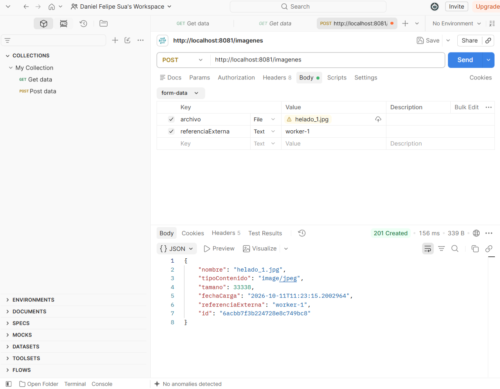
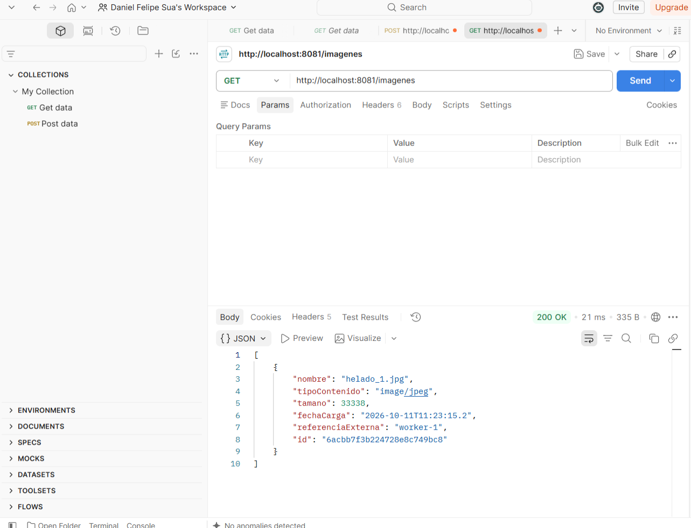
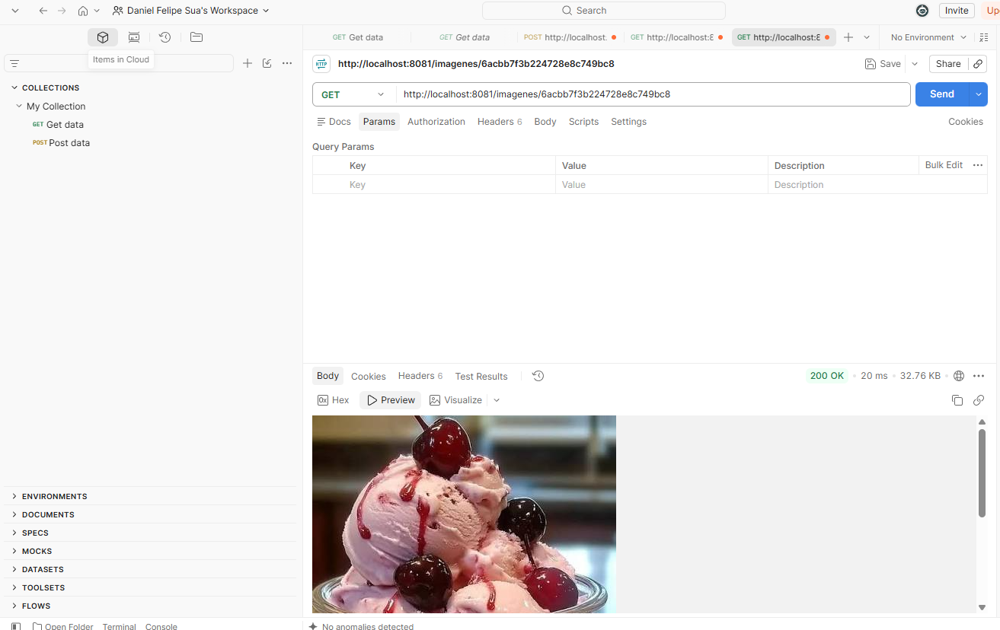
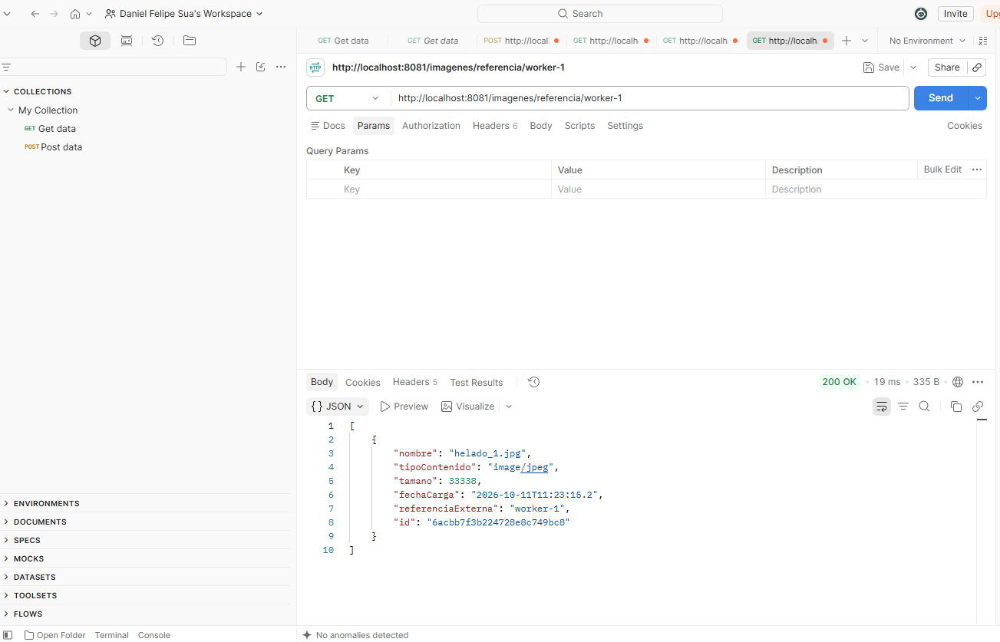
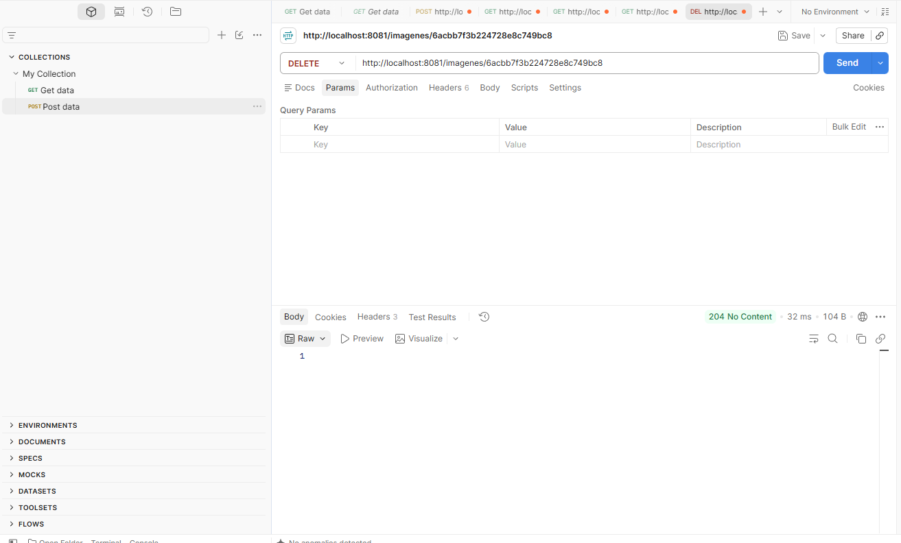
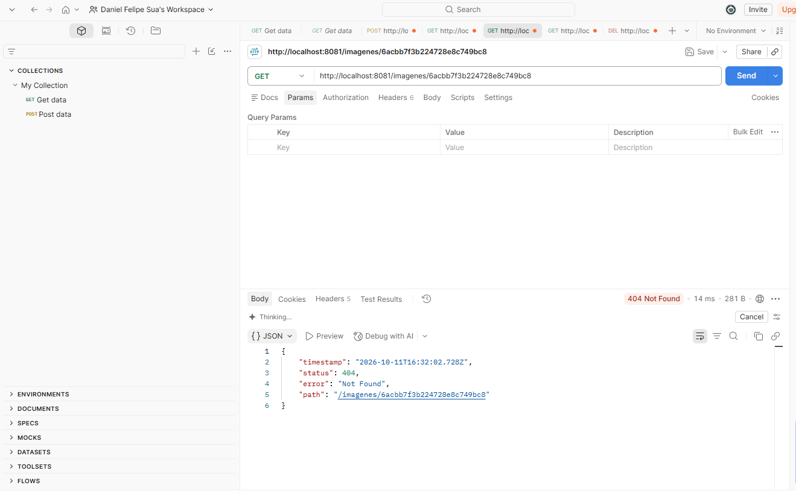
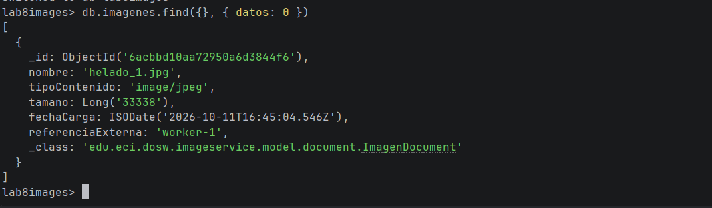

# image-service

Microservicio en Spring Boot que almacena imágenes en MongoDB. Corresponde a la Parte B del Laboratorio 7 de Desarrollo y Operaciones de Software.

## Configuración usada

- MongoDB en Docker (contenedor mongo-lab7, puerto 27017)

- Base de datos lab8images, colección imagenes

- Microservicio en el puerto 8081

- Spring Boot 4.1.1: la URI de conexión se lee de spring.mongodb.uri. También se deja spring.data.mongodb.uri, que es la propiedad que indica el enunciado.

## Evidencia del almacenamiento de imágenes en MongoDB

Las pruebas se hicieron con Postman.

### 1. Subir una imagen

POST /imagenes con archivo y referenciaExterna. Respuesta 201 Created.

### 2. Listar imágenes

GET /imagenes. Respuesta 200 OK.

### 3. Consultar una imagen por id

GET /imagenes/{id}. Respuesta 200 OK con la imagen.

### 4. Listar imágenes por referencia externa

GET /imagenes/referencia/{referenciaExterna}. Respuesta 200 OK.

### 5. Eliminar una imagen

DELETE /imagenes/{id}. Respuesta 204 No Content.

### 6. Consulta posterior a la eliminación

La imagen eliminada ya no se encuentra.

### 7. Colección en MongoDB

Documento guardado en la colección imagenes de la base lab8images, consultado con mongosh.

